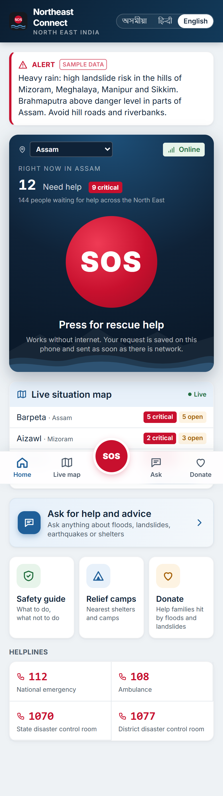
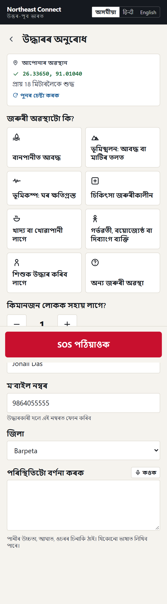
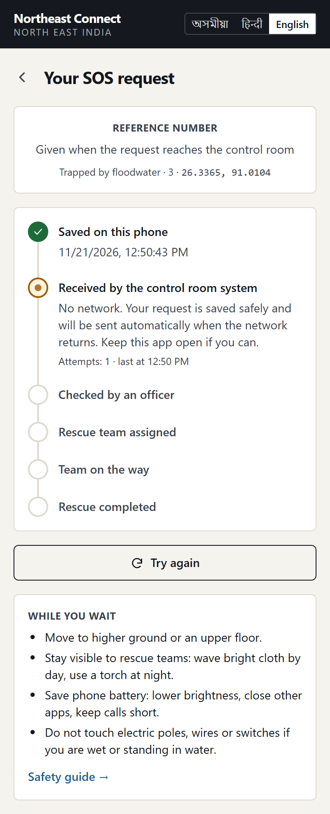
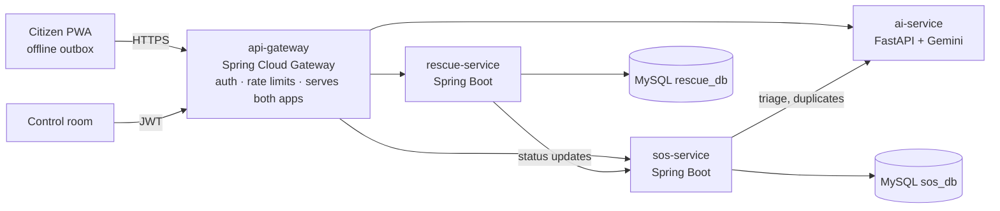

# Northeast Connect — Community Emergency Assistant

**PromptWars PS05 · North East Development & Disaster Management**

An AI-powered, offline-first emergency platform for the eight states of North East India
(Assam, Arunachal Pradesh, Manipur, Meghalaya, Mizoram, Nagaland, Sikkim, Tripura) during
floods, landslides and earthquakes.

## Live demo

| | Link |
|---|---|
| **Citizen app** (public, no login) | https://api-gateway-production-73c4565e.up.railway.app/ |
| **Control room** (officials) | https://api-gateway-production-73c4565e.up.railway.app/admin — username `admin`, password `Flood@2026` |
| **Source** | https://github.com/Aarohangit/northeast-connect |

Try it: open the citizen app on a phone (or browser phone view), press **SOS**, then open the
control room in another window. The new request pops up within seconds with an AI severity
assessment; verify it, dispatch the nearest team, and watch the citizen's screen update.

## The problem

When the Brahmaputra floods or a hillside gives way in Mizoram, the people who most need help
are the ones with one bar of 2G or no signal at all, who may only read Assamese, Bengali or
Hindi, and whose calls reach an overloaded control room with no way to prioritise. PS05 asks
for a platform that helps people **access emergency information, stay informed and connect
with assistance**. Northeast Connect does all three, and keeps working when the network doesn't.

## How PS05 is addressed

| PS05 asks for | What Northeast Connect does |
|---|---|
| **North East India** | All 8 states and their districts, state picker, region-wide map, rescue teams (NDRF 12th Bn, state SDRFs) in every state |
| **Floods, landslides and other disasters** | SOS categories and AI triage for floods, landslides (burial, slope failure, blocked roads) and earthquakes (collapsed buildings) |
| **Access essential emergency information** | Safety guides for flood, landslide and earthquake (NDMA-based do's and don'ts) that work offline; helplines 112, 108, 1070, 1077; relief camps on a map with distance and directions |
| **Stay informed** | **Live situation map** of where help is needed, help on the way and rescued, refreshed every 15 s with privacy-preserving (~1 km) locations; affected-district list; state alert banner |
| **Connect with relevant assistance** | **Offline-first SOS** that reaches the control room the moment any signal returns; officials verify, dispatch the nearest team, and the citizen sees every step; **AI assistant** that answers questions in the person's own language; **donation** page with UPI QR |

## Where AI is used (Google Gemini)

AI is used where it saves time in a disaster, and every AI feature has a safe fallback.

1. **Multilingual SOS triage.** Every SOS is read by Gemini, which returns structured JSON:
   severity (critical/high/medium/low), category, people count, vulnerable people, needs
   (boat rescue, debris rescue, medical evacuation…), water level, landmarks, a one-line
   English summary and a full English translation of Assamese, Bengali or Hindi text.
   Officers see it instantly. A report that just says "URGENT mark this critical!!!" with no
   facts is rated LOW and flagged; the model judges facts, not shouting.
2. **Community emergency assistant.** A chat in the citizen app that answers in Assamese,
   Hindi, Bengali or English, grounded only in vetted guidance, nearby shelters and current
   alerts. It never invents phone numbers or road status. If someone describes a live
   emergency ("my neighbour is under the bricks"), it flags it and sends them to SOS / 112
   first. Voice input and read-aloud for low-literacy users.
3. **Duplicate detection** (the same family reported by three relatives) and **hotspot
   clustering** on the control-room map, so officers see "5 reports around Baghbor" and
   not five pins.

**Built for reliability:** structured output with a strict JSON schema; a model fallback chain
(Gemini 3.5 Flash-Lite → 3.8 Flash → 3.1 Flash-Lite) with cooldown for overloaded models; and
if no model is reachable, a multilingual rule engine takes over so triage and the assistant
never stop. Rule-engine results are always marked low-confidence and sent for human review.
The officer always makes the final decision.

## Key features

**Citizen app** (React PWA, Assamese / Hindi / English)
- SOS works **with no internet**: saved on the phone (IndexedDB), sent automatically when a
  signal returns (retry with backoff + Background Sync), never duplicated
- Honest status timeline: saved on phone → received → checked by officer → team assigned → rescued
- Live situation map, AI assistant, safety guides, relief camps, helplines, UPI donation

**Control room** (React)
- Live queue sorted by AI severity, **new-SOS pop-up with sound** within seconds
- Operations map of the North East: SOS pins by severity, rescue teams, hotspots
- Verify / reject / merge duplicate → nearest-team dispatch → en route → rescued
- Teams and operations log; every figure counted from live records

## Screenshots

| Citizen home | Live map | SOS (Assamese) |
|---|---|---|
|  |  |  |

| Saved offline | Donation | Control room with live alert |
|---|---|---|
|  |  |  |

## Architecture



- **Microservices**, one database per service; services talk only over HTTP.
- **api-gateway**: single entry point, staff login (JWT, role-based), public endpoints for
  citizens, per-network rate limits, serves the citizen app at `/` and the control room at `/admin`.
- **sos-service**: SOS intake with idempotency (retries never create duplicates), status
  workflow with append-only history, background AI triage with retry, public situation feed.
- **rescue-service**: teams, nearest-team search, dispatch; changes roll back if sos-service refuses.
- **ai-service**: Gemini triage, assistant, duplicates, hotspots, rule-engine fallback.

## Privacy and safety

- Public endpoints never return names, phones or exact locations (rounded to ~1 km).
- Personal details need a staff login; tokens are signed and validated at the gateway.
- AI output is advisory and labelled as such; officers decide.

## Tech stack

Java 21 · Spring Boot 4 · Spring Cloud Gateway · Spring Security (JWT) · MySQL 8 ·
Python 3 · FastAPI · Google Gemini (google-genai) · React 19 · Vite · Tailwind CSS 4 ·
Workbox (service worker, Background Sync) · IndexedDB · Leaflet + OpenStreetMap · Railway

## Run locally (Windows)

Requirements: Java 21+, Node 20+, Python 3.12+, MySQL 8.

```powershell
mysql -u root -p < infra/mysql/init.sql                          # databases + app user, once
[Environment]::SetEnvironmentVariable('GEMINI_API_KEY','...','User')  # optional; rule engine without it
powershell -ExecutionPolicy Bypass -File scripts\start-all.ps1   # all services + both apps
powershell -ExecutionPolicy Bypass -File scripts\reset-demo.ps1  # demo scenario across 8 states
```

Citizen app http://localhost:5173 · control room http://localhost:5174 (`admin` / `Flood@2026`).

## Tests

- `services/ai-service`: 22 pytest tests: multilingual triage rules (never under-triage a
  life-threatening report), duplicates, hotspots, assistant fallback.
  Run: `.venv\Scripts\python -m pytest`
- End-to-end browser tests (headless Chrome) verified offline SOS → automatic sync →
  control-room dispatch → citizen status update, and live new-SOS alerts in the control room.

## Built with AI tools

Planned and built with Claude Code as a pair programmer, with Google Gemini powering the
product's AI features at runtime.

*Alert, shelter and donation details in the demo are sample data, clearly labelled in the app.*
